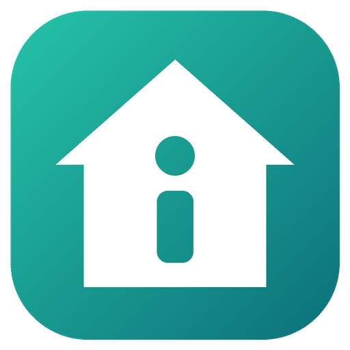

<p align="center">
  
</p>

<h1 align="center">InelsForHass</h1>

<p align="center">
  Integrace chytré elektroinstalace <b>iNELS BUS</b> od ELKO EP do Home Assistantu,<br>
  připojená přes iNELS <b>Connection Server</b> protokolem XML-RPC.
</p>

<p align="center">
  <a href="https://github.com/JH-Soft-Technology/InelsForHass/releases"></a>
  <a href="https://hacs.xyz"></a>
  
  <a href="https://github.com/JH-Soft-Technology/InelsForHass/actions/workflows/validate.yml"></a>
  <a href="LICENSE"></a>
</p>

<p align="center">🌐 <a href="README.md">English version</a></p>

---

## ✨ Co umí

| Platforma | Zařízení iNELS | Co dostanete |
|---|---|---|
| 💡 `light` | spínaná a stmívaná světla | zapnutí/vypnutí, jas u stmívačů |
| 🔌 `switch` | relé, zásuvky, brány a garážová vrata | zapnutí/vypnutí |
| 🪟 `cover` | rolety a žaluzie | otevřít, zavřít, zastavit |
| 🌡️ `climate` | regulátory vytápění místností (`heat-control`) | aktuální a žádaná teplota, úroveň topení jako preset |
| 📈 `sensor` | regulátory vytápění místností | teplota místnosti s historií a statistikami |

- Nastavení z UI (config flow), bez YAML.
- Lokální dotazování každých 5 s, bez cloudu.
- Používá knihovnu [`pyinels`](https://github.com/JH-Soft-Technology/pyinels).

**Plánováno:** meteostanice, rádio Lara.

---

## 🧭 Jak to funguje

```
Home Assistant ──XML-RPC──▶ iNELS Connection Server ──▶ centrální jednotka (CU3) ──▶ zařízení na sběrnici
                 :8001
```

Integrace komunikuje s **iNELS Connection Serverem**, ne přímo s centrální jednotkou. Vidí všechna zařízení a proměnné, které Connection Server publikuje z projektu iNELS IDM (`export.pub`). V PLC se nic měnit nemusí.

---

## 🚀 Instalace

### 1. Instalace přes HACS

[](https://my.home-assistant.io/redirect/hacs_repository/?owner=JH-Soft-Technology&repository=InelsForHass&category=integration)

Nebo ručně: **HACS → ⋮ → Vlastní repozitáře** → `https://github.com/JH-Soft-Technology/InelsForHass`, typ **Integrace** → stáhnout **Inels over XMLRPC** → restartovat Home Assistant.

<details><summary>Ruční instalace bez HACS</summary>

Zkopírujte `custom_components/inels_rpc` do `/config/custom_components/` a restartujte Home Assistant.
</details>

### 2. Přidání integrace

[](https://my.home-assistant.io/redirect/config_flow_start/?domain=inels_rpc)

**Nastavení → Zařízení a služby → Přidat integraci → Inels over XMLRPC** a vyplňte:

| Pole | Příklad | Poznámka |
|---|---|---|
| Adresa | `192.168.1.10` | IP adresa nebo název Connection Serveru; `http://` se doplní automaticky (hodnota s `http://` se přijme také) |
| Port | `8001` | XML-RPC port Connection Serveru (výchozí `8001`) |
| Centrální jednotka | `CU3` | typ centrální jednotky (výchozí `CU3`) |

Stejný Connection Server (adresa a port) lze přidat jen jednou.

### Změna adresy

Když Connection Server dostane novou IP adresu nebo port, otevřete **Nastavení → Zařízení a služby → Inels over XMLRPC → ⋮ → Změnit nastavení**. Před uložením se ověří spojení; entity, jejich ID i historie zůstanou zachované.

### Přechod z verze 0.4.x

- Stávající položka se převede automaticky, nic není potřeba nastavovat znovu.
- **ID entit se nemění**, automatizace, skripty i nástěnky fungují dál.
- **Zobrazované názvy** se nově řídí pravidly Home Assistantu: hlavní entita zařízení má název zařízení, senzor teploty se zobrazuje jako `<regulátor> Teplota v místnosti` (dříve `<regulátor> temperature`). Názvy, které jste si sami změnili, zůstanou.
- V registru zařízení je jako model uveden typ zařízení iNELS (`light`, `switch`, `door`, `shutter`, `heat-control`) a výrobce ELKO EP.
- Rolety už nehlásí vymyšlenou polohu (centrální jednotka ji nezná), takže po restartu není zablokované tlačítko Zavřít.

---

## 🌡️ Vytápění

Každý regulátor místnosti v iNELS se v HA objeví jako entita `climate` (režim `heat`) a k tomu `sensor` teploty místnosti.

| Proměnná iNELS | Použití |
|---|---|
| `<místnost>_Temperature` | aktuální teplota |
| `<místnost>_StateTH` | žádaná teplota (jen pro čtení) |
| `<místnost>_StateM/U/N/K` | aktivní úroveň topení |
| `<místnost>_VM/VU/VN/VK` | přepnutí úrovně topení |

**Presety = úrovně topení iNELS:**

| Preset | Úroveň iNELS |
|---|---|
| Minimum | Minimum |
| Útlum | Útlum |
| Normál | Normál |
| Komfort | Komfort |

- **Žádaná teplota se nedá nastavit přímo.** Centrální jednotka ji počítá z aktivní úrovně a teploty úrovní se nastavují v iNELS IDM. Výběr presetu zapíše `<místnost>_V<úroveň>=1`, změna se projeví zhruba do 10 sekund.
- **Časové programy iNELS běží dál.** Preset zvolený z Home Assistantu platí jen do další změny v programu.
- Stav ventilů ani poptávku po teple Connection Server nepublikuje, nejsou proto k dispozici.

> [!TIP]
> Každá změna presetu je zápis do centrální jednotky. Když úrovně přepínáte automatizací, zapisujte jen při skutečné změně a použijte hysterezi a minimální interval.

> [!NOTE]
> Pokud proměnné úrovní regulátoru nejsou exportované, integrace čte jen teploty.

---

## 🔄 Aktualizace dat a nedostupnost

- Seznam zařízení se načte jednou při startu integrace. Hodnoty všech zařízení se pak čtou každých **5 sekund** jedním požadavkem.
- Příkazy se odesílají postupně, jeden po druhém. Odeslaný stav se zobrazí hned a drží se, dokud ho nepotvrdí čtení z jednotky (nejvýš 6 s, u presetů topení 20 s), takže entita neproblikává, než centrální jednotka změnu provede.
- Každé volání Connection Serveru má časový limit 10 sekund, zaseknutý server tak nezablokuje Home Assistant.
- Zařízení, jehož proměnnou Connection Server nepublikuje, se přeskočí (s varováním v logu) a nerozbije celou platformu.
- Když Connection Server při startu Home Assistantu neodpovídá, integrace se zkouší nastavit znovu automaticky. Když přestane odpovídat později, všechny její entity přejdou do stavu **nedostupné** a vrátí se po prvním úspěšném čtení; výpadek se zaloguje jednou.
- Příkaz, který se nepodaří doručit, zobrazí v UI chybu (a zastaví krok automatizace), místo aby se tiše ztratil.

### Nová a odebraná zařízení

- **Nová zařízení** publikovaná Connection Serverem se objeví po znovunačtení integrace (**⋮ → Znovu načíst**) nebo po restartu Home Assistantu.
- Zařízení, která Connection Server už nepublikuje, se při dalším startu nebo znovunačtení automaticky odeberou. Takové zařízení jde smazat i ručně na jeho stránce.

---

## ⚠️ Známá omezení

- Rolety umí jen otevřít, zavřít a zastavit; poloha není známa.
- Žádaná teplota topení je jen pro čtení (viz [Vytápění](#️-vytápění)).
- Integrace se dotazuje periodicky; změny provedené jinde (vypínače, aplikace iNELS) se projeví do 5 sekund.
- Podporovány jsou jen typy zařízení uvedené v sekci [Co umí](#-co-umí).

---

## 🛠️ Řešení potíží

- **Nepovedlo se připojit:** zkontrolujte adresu a port a že je XML-RPC port Connection Serveru z Home Assistantu dostupný.
- **Diagnostika:** **Nastavení → Zařízení a služby → Inels over XMLRPC → ⋮ → Stáhnout diagnostiku** uloží soubor s nastavením integrace (bez adresy serveru), seznamem zařízení (typ, id, název, místnost) a jejich posledními hodnotami. Přiložte ho k issue.
- **Chybí zařízení:** integrace vidí jen to, co Connection Server publikuje. Zkontrolujte zařízení v `export.pub` (administrace Connection Serveru → Configuration → CU config).
- **Ladicí log:**

  ```yaml
  logger:
    logs:
      custom_components.inels_rpc: debug
      pyinels: debug
  ```

---

## 🗑️ Odebrání integrace

1. **Nastavení → Zařízení a služby → Inels over XMLRPC → ⋮ → Smazat.** Tím se odebere položka se všemi zařízeními a entitami. V iNELS se nic nemění.
2. Pokud jste instalovali přes HACS: **HACS → Inels over XMLRPC → ⋮ → Odebrat**. U ruční instalace smažte `/config/custom_components/inels_rpc`.
3. Restartujte Home Assistant.

---

## 🐞 Chyby a návrhy

Narazili jste na chybu nebo vám chybí zařízení? [Založte issue](https://github.com/JH-Soft-Technology/InelsForHass/issues) a přiložte verzi Home Assistantu, verzi integrace a ladicí log.

## 📄 Licence

[MIT](LICENSE). iNELS je ochranná známka společnosti ELKO EP, s.r.o. Projekt není s ELKO EP spojen ani jím schválen.

<p align="center">
  <a href="https://www.buymeacoffee.com/jhoralek"></a>
</p>
